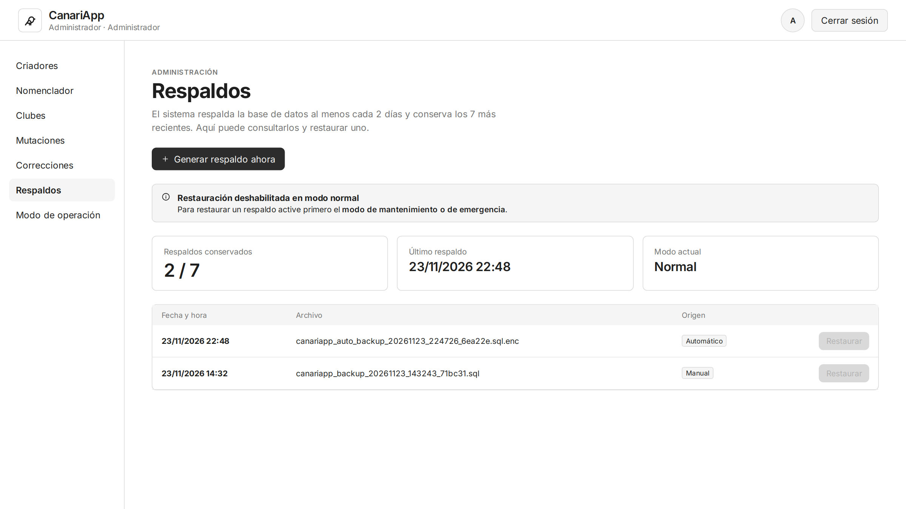

# Evidencia: respaldo real de Neon con `respaldo-neon` (DAT-003)

Registrado el 24-11-2026 para QA, que no tiene acceso a Neon. Todo lo de abajo es salida real de los comandos indicados, tomada en el PC que ejecuta el servicio; el host de Neon se muestra abreviado (`ep-sweet-pine-….neon.tech`).

## 1. Servicio en ejecución

```text
$ docker compose --profile neon ps respaldo-neon
canariapp-respaldo-neon-1 | Up 2 hours | creado 2026-11-23 22:47:21 -03

$ docker compose --profile neon logs respaldo-neon
CanariApp: servicio de respaldo de ep-sweet-pine-….neon.tech/neondb (cron diario 03:00, respalda si pasaron 48 h)

$ docker compose --profile neon exec respaldo-neon sh -c "grep auto_backup /etc/cron.d/canariapp-backup; pgrep -a cron"
0 3 * * * www-data . /etc/canariapp.env && /usr/local/bin/php /var/www/app/bin/auto_backup.php >> /var/www/app/storage/logs/auto_backup.log 2>&1
1 cron -f
```

## 2. Primer respaldo (23-11-2026 22:47, Chile)

```text
$ docker compose --profile neon exec -u www-data respaldo-neon sh -c ". /etc/canariapp.env && php bin/auto_backup.php --force"
[OK] Respaldo automático generado: canariapp_auto_backup_20261123_224726_6ea22e.sql.enc (ID #2, rotados: 0)

$ ls -l storage/backups        # volumen canariapp_backups_neon, fuera del contenedor
-rw-r----- 1 www-data www-data 14415213 2026-11-23_22:48 canariapp_auto_backup_20261123_224726_6ea22e.sql.enc
```

Permisos `0640`: solo el usuario del servicio lo lee.

## 3. El archivo está cifrado y es un volcado completo de Neon

```text
$ head -c 15 canariapp_auto_backup_20261123_224726_6ea22e.sql.enc
CANARIAPP-ENC1                      # cabecera del formato cifrado (AES-256-GCM), no es SQL legible

$ php bin/decrypt_backup.php …sql.enc > /tmp/v.sql   # con BACKUP_ENCRYPTION_KEY; /tmp/v.sql se borró después
-- Dumped from database version 18.7 (84da7d8)       # servidor Neon
-- Dumped by pg_dump version 18.7 (Debian 18.7-1.pgdg12+5)   # cliente 18 elegido automáticamente
CREATE TABLE: 28
COPY de datos: 28
-- PostgreSQL database dump complete
```

## 4. Registro en la base de Neon

```text
$ psql (Neon, rol dueño, solo lectura)  SHOW server_version;
 18.7 (84da7d8)

 id_respaldo |     fecha_chile     |                       archivo                        |   origen
-------------+---------------------+------------------------------------------------------+------------
           1 | 2026-11-23 14:32:43 | canariapp_backup_20261123_143243_71bc31.sql          | 1
           2 | 2026-11-23 22:48:12 | canariapp_auto_backup_20261123_224726_6ea22e.sql.enc | automatico

 id_auditoria | accion | entidad  | id_registro |     fecha_chile     |                    motivo
--------------+--------+----------+-------------+---------------------+----------------------------------------------
          115 | insert | respaldo |           2 | 2026-11-23 22:48:15 | Respaldo automático programado (cada 2 días)
```

El respaldo #1 es anterior a este cambio (generado sin cifrar, antes de DAT-003 nuevo).

## 5. Panel del administrador en el sitio publicado (Vercel)



El panel muestra el respaldo automático `.sql.enc` registrado en Neon y la restauración deshabilitada en modo normal (RF029). La restauración de Neon se hace desde el Docker de respaldo con el sistema en mantenimiento: ver [`docs/respaldos_neon.md`](../respaldos_neon.md).
